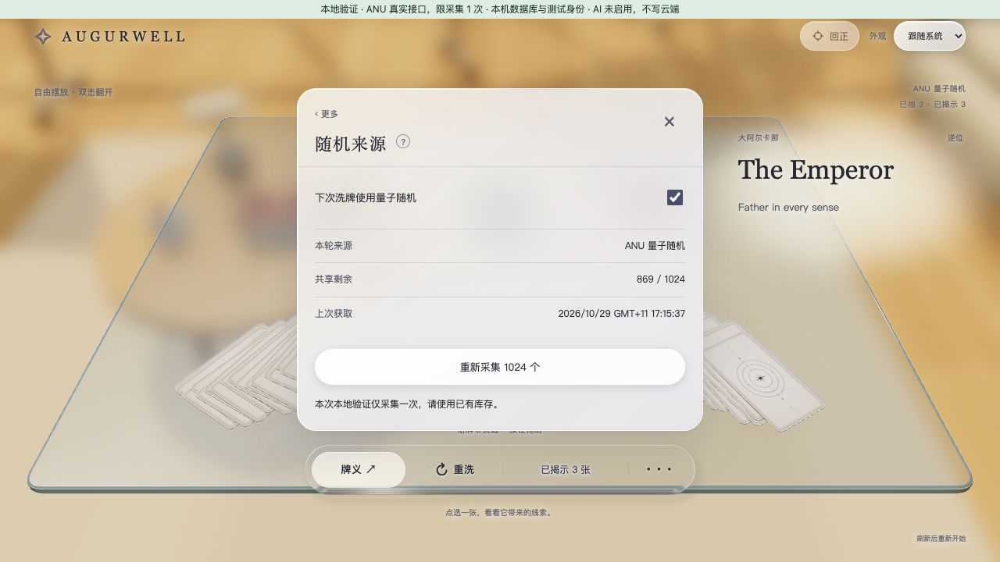
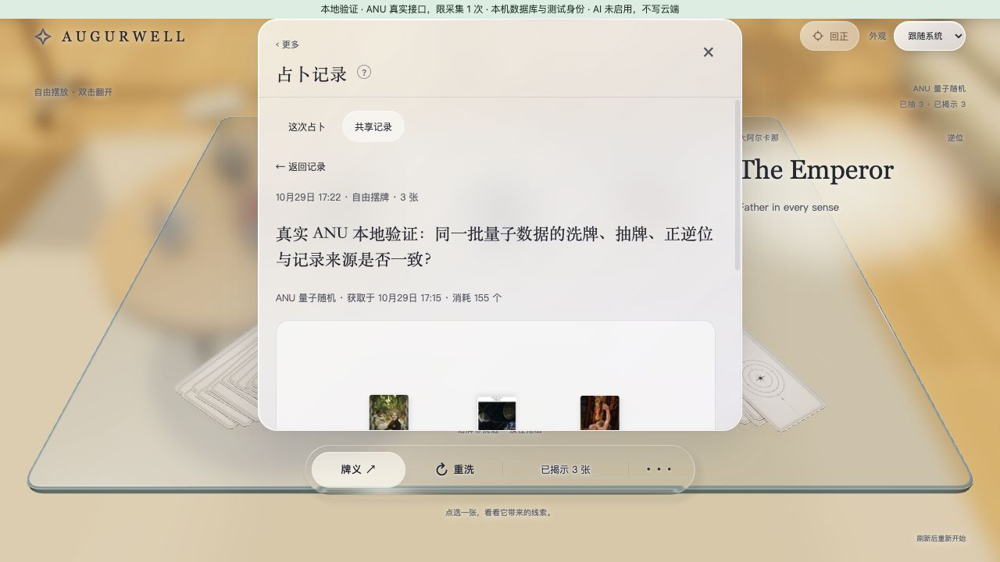

# stage2.5.5.3 — one real ANU acquisition locally

Parent and authority: governance/STATE.md stage2.5.5.3. This is bounded validation evidence, not a separate plan. The user authorised one real ANU acquisition, local shuffle/draw validation and local commit; no publication, cloud migration or paid AI.

## Local setup

The owner enters `ANU_API_KEY` in ignored `.local/anu-live.env` (mode0600). It is read only by `scripts/lib/anu-live-provider.mjs`, never echoed or included in browser code. The separate `pnpm dev:anu-live` command uses port5176 by default; it never turns the synthetic preview into a live provider.

A dedicated retained `.local/anu-live-pg` cluster uses PostgreSQL over a private Unix socket, fsync/synchronous_commit enabled, and the production random/records SQL adapters. Only migrations001 and003 are explicitly applied to a newly created local cluster. Restarts verify migration hashes and do not replay migrations. This is local persistence, not hosted Neon or two-account qualification.

The one-call attempt marker in `.local/anu-live/attempt.json` is synced before dispatch. It remains consumed after failure or restart. Private bounded response bytes and a digest/status receipt allow offline diagnosis of an unexpected format without requesting more entropy. Never delete/reset the marker to retry without a new authorisation. New collection is refused after the budget is spent; the original operation ID retains normal recovery/idempotency behavior.

The loopback harness uses a signed synthetic local identity with the existing access guard. Strict Host and write-Origin checks apply. HMR is disabled; all `.local` paths are denied to the live Vite server, and its dependency cache is outside that directory. Real Cloudflare identity, direct-origin protections and production audience are unchanged and untested here. AI is unavailable; saved readings remain local.

## Verification status

Complete. Exactly one network dispatch was made on2026-10-29 at06:15:37.089Z. ANU returned HTTP200 at06:15:37.943Z (about855ms),7071 bytes, `success:true`, `type:"uint16"`, `length:"1024"`, and1024 validated integers in0..65535. Response SHA256: `d5c8534a622a7988eb5d9b931d25a3a01ff90f563835343c8a389268b58a9b74`. Private bytes/receipt remain ignored under `.local/anu-live`; raw values and key are not tracked.

The first live response exposed a contract mismatch: ANU's `length` is a string; the previous provider accepted only a number. The original collection therefore terminated as failed and its history remains intact. The provider now accepts exactly1024 or exactly`"1024"`, retaining strict success/type/array-length/range checks. Tests reject coercion-like variants such as`"01024"`, whitespace, booleans and arrays.

`node scripts/import-anu-response.mjs` validated the retained response offline with the corrected production parser and imported it through the production SQL into a still-pristine local pool. It never reads a key or uses network transport. Its durable fixed import ID is bound to the original failed operation/hash. Original request/receipt timestamps are retained, with separate import timestamps in a private manifest. A second execution returned the same batch and1024 inventory, without refill or another ANU call. Completed imports cannot refill consumed inventory. This is a later offline restoration of the single real response, not a second acquisition or an unobserved fresh provider round trip.

Browser verification used the actual app: click Start, allow the normal animation, drag three cards, reveal via button and double click, fill a synthetic test question, save, reopen the record, toggle the next-shuffle mode and attempt a blocked repeat collection. First shuffle:1024→869, consumed155,78 unique cards and78 orientations. Selected cards: Queen of Disks upright, The Emperor reversed, Princess of Wands upright. Stored record source/batch/consumption matched the completed allocation; current table and inventory survived toggle and blocked collection. Original acquisition time displayed17:15 local; local record saved17:22.

The real local service was stopped and restarted after saving. Remaining869, the saved three-card record and its provenance survived; dispatch budget stayed consumed. The task-owned preview/PostgreSQL were gracefully stopped at closeout, with retained data and no leftover lifecycle lock. Local operator stop needed sandbox escalation for the already-escalated child process. A stale lock after a process-group interrupt was removed only after confirming both owner process and PostgreSQL were stopped; helper cleanup now handles confirmed already-stopped servers without treating ambiguous outcomes as safe.

Final `pnpm check:all`:314 tests pass (15 access,132 reading,44 records,58 AI,65 random), plus TypeScript, governance structure, four compiled API checks and build. `pnpm check:random-postgres`:15 isolated checks pass, including the original12 production SQL checks and3 lifecycle/concurrency/restart checks. Five new offline one-shot tests and the live-string format regression are included in the aggregate. Independent Codex agents reviewed the provider, private-file boundary, import binding and process ownership; this stage did not request another Claude review.

`node scripts/check-anu-local-http.mjs` confirms four filesystem/encoded/raw/url private sentinel variants return403; a relative SPA path returns only public HTML with no sentinel content. Wrong Host and write Origin return403, AI returns503, acquisition budget unchanged. Vite's disabled HMR client reports expected WebSocket connection errors; no gameplay exception was observed. Existing public-asset development and bundle-size warnings remain. These local checks do not qualify production transport/authentication or physical-device performance.

## Cost and external facts

The official [ANU pricing page](https://quantumnumbers.anu.edu.au/pricing), rendered in the browser on2026-10-29, shows Trial at$0/request,100 requests/month and1 request/second. This task uses the owner's stated free key and one request of1024 uint16 values. No subscription is changed; no billing reconciliation is claimed. [Request documentation](https://quantumnumbers.anu.edu.au/documentation) supplies the endpoint/header/type/length contract.
