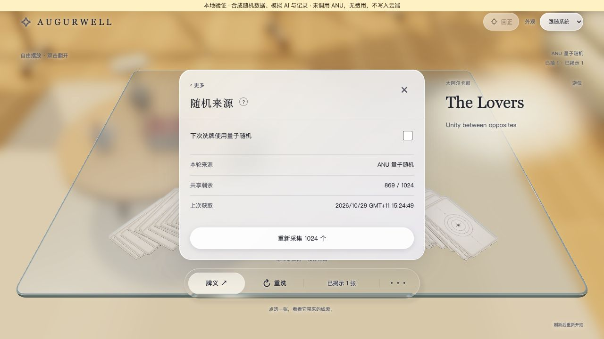
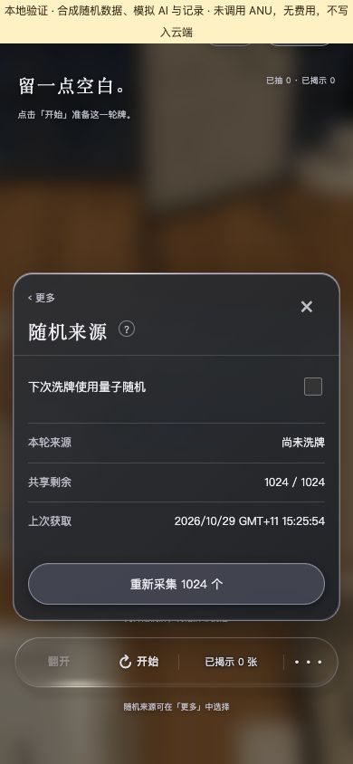

# stage2.5.5 — local shared quantum pool

Parent and current-state owner: [governance/STATE.md stage2.5.5](../../../governance/STATE.md). This document is bounded implementation evidence and a cross-review packet, not a parallel plan. Design owner: [DESIGN.md revision24](../../../DESIGN.md).

## Authority and delivery

The user2026-10-29 approved the shared pool, manual acquisition/replacement, per-device next-shuffle switch and shortage preservation, then explicitly requested local implementation/tests/commit followed by deep Claude Code review in the existing tarot workspace. Codex is the sole source writer; Claude is a read-only reviewer. No push, deployment, production schema/key activation or live ANU invocation belongs to this slice.

## Contract and source owners

- `shared/randomness.mjs`: raw78-card permutation and independent orientation values. Each Fisher–Yates bound n accepts only u < floor(65536/n)*n before u mod n; each residue has exactly floor(65536/n) representatives. Each orientation consumes a separate word and uses u <32768. Minimum77+78=155; rejection consumption is counted. No entropy expansion, random-key sorting or PRNG fallback. Uniformity is conditional on independent uniform input; these checks do not certify the physical laboratory source.
- `server/random/provider.mjs`: one official ANU request for exactly1024 uint16 values, server header key, bounded response/timeout, strict type/length/range validation, no automatic retry or redirect. Failure never clears the old inventory.
- `server/random/neon-store.mjs`: one shared pool with versioned compare-and-swap and durable operation claims. Pool movement/replacement and completed-operation receipt are transactional. A60-second fenced collection lease and1-second acquisition interval apply across server instances. Late responses cannot overwrite a newer collector; losing draw candidates are never exposed.
- `server/random/service.mjs` and `api/random.ts`: existing signed identity gate, same-origin JSON writes, bounded requests, code-only error logging, private/no-store responses. Operation IDs deduplicate provider calls and draws. GET/replay can terminate expired pending work under the same operation lock; this is metadata reconciliation with zero provider calls. Completed work wins if already committed. Terminal unknown allows a new manual action; uncertainty is never an automatic retry.
- `client/src/reading-random-data.mjs`, `reading-random.mjs`, `reading.mjs`: no acquisition/draw on load or toggle; explicit initial start; await success before clearing current table/drafts; apply existing deterministic animation interleave exactly once. Unknown requests retain a per-tab ID. GET404 enables an explicit continuation of that same ID, not a new automatic request. Recovered decks wait for explicit next quantum shuffle. Ordinary mode uses Web Crypto and stays clearly labelled.
- `shared/random-provenance.mjs` and records integration: server verifies completed allocation and supplied orientation before storing quantum metadata; old-batch records survive replacement, legacy records stay unknown. This does not attest which browser gestures occurred or prevent intentional card selection by an authorised caller.

## Verification

The aggregate gate passed governance structure, TypeScript, compiled access/records/AI/random entrypoints, production build and295 tests. Two final UI-only fixes added the missing-configuration regression and corrected first-shuffle progress; the focused52-test randomness suite and production build passed afterward. Total covered tests:296 (15 access,129 reading,44 records,56 AI,52 random). The small final provenance bounds strengthening was rechecked with the record suite. Existing asset/chunk-size development warnings are unchanged.

The10 math tests enumerate all65,536 possible words at every bound2..78, exhaust all five-card permutations, verify equal orientation partitions, and cover rejection/exhaustion/offset/input immutability. Service/provider tests cover signed access, same-origin, provider validation, concurrent claims/draws, lost responses, invalid/refused acquisition, stale lease fencing, pending expiry and completion races. Client tests cover empty startup, mode persistence, no implicit source fallback, rapid duplicate actions, stable recovery ID, terminal/nonterminal uncertainty and explicit same-ID continuation. Record tests reject forged metadata/orientation and keep legacy compatibility.

`pnpm check:random-postgres` passed12 checks against isolated PostgreSQL17.10 with the **actual production adapter SQL**. This includes duplicate claim/commit, competing cursors, shared collection interval, failure preservation, stale collectors, stale versions, exhausted capacity, atomic rollback and expiry-versus-completion races. Migration SHA256: `84541d4d960d23d10fea037fe84dd72513a1caa62704cf20fb3868845bf68dd1`. The temporary Unix-socket-only database was stopped and removed. This verifies SQL behavior locally, not Neon's HTTP transport or production configuration.

Browser smoke used the explicit loopback fixture, no credentials/cloud/provider calls. Observed: empty quantum pool refuses start without losing the table; acquisition1024→one shuffle869; original draw/reveal still works; toggle and refresh preserve a revealed Lovers card; a record saved after replacement retains the original15:24 batch and155 consumption. A second page sees shared1024 inventory without automatic consumption. Ordinary mode starts with provider count0. Day/night,390×844 panel, Escape focus and reduced-motion controls were checked. Automated coverage handles uncertain-response and concurrency cases that cannot be inferred from screenshots.

## Evidence ceiling and release prerequisites

No real ANU key was read, no ANU request was issued and no quantum physical-source claim is established by the synthetic screenshots. The1024-value capacity and request format follow [ANU documentation](https://quantumnumbers.anu.edu.au/documentation). Last-fetch time is receipt time; the provider does not supply a per-number measurement timestamp in this response contract. Mode changes, collection and source metadata do not imply prediction accuracy.

The65 inherited generated files are preserved byte-for-byte and excluded from staging. Prior frozen AI comparison evidence is outside this patch. Active table persistence, cross-device live table sync, browser refresh recovery of a completed unused deck, real second-user login and physical-phone performance remain outside this feature. New database tables and server key activation must be separately authorised before hosted quantum use; an ordinary Vite preview intentionally returns unavailable.

## Cross-host review

Review target: the local commit carrying this document, diff from `8727ae5ad642b08769e9ab04ef99441bc63c966e`. Requested destination: existing Claude Code tarot chat “10-29 先项目概览” in “My-urban-tarot-miniapp-light”. Review is dispatched only after local commit. Findings and reviewed revision will be recorded separately; preparation of this packet does not claim Claude has reviewed it.
