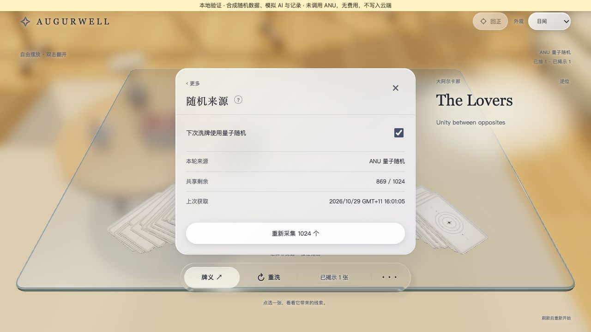

# stage2.5.5.1 — cross-host review and bounded corrections

Parent: [governance/STATE.md stage2.5.5](../../../governance/STATE.md). Scope: review of local feature commit `79bcff654e6821b485cd0dd6b64c23f663ee849b` against `8727ae5ad642b08769e9ab04ef99441bc63c966e`, and Codex's bounded follow-up. This is evidence, not a separate current plan.

## Observed independent review

The requested existing Claude Code chat “10-29 先项目概览” in “My-urban-tarot-miniapp-light” acknowledged the exact commit, completed a read-only review, independently passed all296 aggregate tests and all12 local PostgreSQL checks, and confirmed unchanged inherited-file fingerprints. Its original report is retained in ignored `.local/quantum-claude-review.md`, SHA256 `677195fcbdf113e0b5f9f46af728dcc7b5c15b1318fa044074d93c1e122729e8`. Codex remains the sole tracked-source writer.

Claude accepted the original as a local candidate and recommended two medium-priority improvements before production: missing-schema failure classification, and card-order-dependent visible fan geometry. It found no duplicate provider call/deduction or server deadlock in its reviewed scope. Its large synthetic samples did not establish a reproducible card-frequency bias; empirical absence of a detected bias is not a neutrality proof. Physical ANU source/response and Neon transport remained untested.

## Disposition

| Finding | Bounded action |
|---|---|
| Missing random tables leave a new operation uncertain | Read-only table/column preflight before claim/provider access maps SQLSTATE42P01/42703 to known unavailable. Write/finalization/readback errors retain uncertain status. |
| Fan shape depends on card identities | Give fan generation a separate uint32 presentation seed and reuse existing independent motion seed. Same seed gives identical geometry and picked ordinal across relabelings; visible variation remains. |
| Draw expiry mentions collection quota | Separate draw/collect messages; a fenced pending draw correctly reports no inventory deduction. |
| AI snapshot retains unchecked source | Strip source from normalized AI input, stored snapshot and public readback. Main saved record alone owns allocation provenance. |
| Open panel polls indefinitely | Limit15-second metadata refresh to a two-minute visible visit; close/hidden/dispose stops it; reopening/visibility starts a fresh window. |
| Per-card membership check is redundant | Keep defensive membership/range checks; clarify that per-card provenance verifies orientation and a completed allocation, not actual user selection, order of clicks or anti-cherry-picking. |
| Post-completion reply errors escape async catch | Root follow-up testing exposed this additional issue; await replies so metadata-read failures are sanitized and retain the original recoverable ID. |

The accepted one-click manual replacement remains unchanged; no unrequested confirmation flow was added. Copied browser tabs can recover the same operation/deck without another deduction. Full table/draft persistence and anti-cheating controls are outside this scope.

## Verification of corrections

Final aggregate:308 tests (15 access,132 reading/motion,44 records,58 AI,59 random), plus governance, TypeScript, compiled access/records/AI/random checks and build. The SQL adapter and migration are unchanged from the12-check local PostgreSQL result. Added regressions cover relabeling and real ray picking at several views,512 independent layouts, missing schema before versus after claim, AI source removal on submit/replay/readback, and bounded polling lifecycle.

Final synthetic browser flow: acquire1024, explicitly shuffle to869, draw/reveal, invoke one mock AI interpretation, save the joint record. Direct fixture readback confirms main record source `anu`/consumed155 and no `randomness` on the nested AI snapshot. Browser warnings/errors were empty. No real provider, cloud database or credential calls occurred.

## Evidence limits and numerical correction

The original reviewer report hardcodes a maximum rejection fraction16/65536. Exhausting bounds2..78 gives the actual maximum64/65536 at bound66 (1/1024). This reporting error does not change the tested equal-residue mapping. We rely on exhaustive conversion checks and the corrected structural independence property, not aggregated Monte Carlo p-values as proof.

The default database isolation remains PostgreSQL Read Committed in the local test. A future activation must verify the hosted setting; stricter isolation can safely reject concurrent writes and needs qualification. Runtime assumptions: provider timeout10s, client timeout20s, function limit30s, collection lease60s; application and database clocks must be reasonably synchronized. No live timing/transport guarantee follows from local checks.

ANU's JavaScript-rendered current documentation was re-read through the browser: `uint16` spans0..65535, array length1..1024, URL `https://api.quantumnumbers.anu.edu.au`, `x-api-key` header. This confirms request construction, not the uncalled live response's metadata types. Preserve strict data validation and verify real response format in an authorised activation step.

## Follow-up review status

Claude completed the bounded delta review of `af7cf339d76c7f64afd066fa217117aeabba999a` against `79bcff65`, independently passing all308 aggregate tests, five focused fault/identity probes and2048 sampled fan-layout clearance checks. The verdict was sufficient corrections, no new blocking finding and no observed behavioral regression. Receipt: ignored `.local/quantum-claude-review-followup.md`, SHA256 `08b19b44b4e01b2c0705b715f2aa21a8718a6a88791480af1b9d4db1bfb378c0`.

One low-priority test-only finding remained: the existing dock clearance test varied card identities but omitted the new independent layout seed. Codex restored128 distinct seeded layouts and added an assertion that all128 geometries differ; the five focused dock tests passed in both Codex and Claude's read-only rerun of the working patch. This final closeout changes only that test and evidence documents; product source remains exactly the independently reviewed `af7cf339`. A final aggregate rerun also passes308 tests and build.

The schema probe detects absent tables and missing columns explicitly referenced by its reads (`id`, `document`, `singleton`); it is not a full schema-version validator. Other partial-schema failures remain conservative/uncertain. The003 migration is transactional; future migrations must extend this qualification. Saved local test records from the first candidate may still contain their old nested AI snapshot; no such candidate was published.

Local implementation, tests, commits and the requested cross-host review are complete. User visual acceptance and future release work remain separate. Push, deployment, production migration/key activation remain unauthorised by this work.
